# CareKoala

**Local screen-text analysis with encrypted guardian check-ins.**

CareKoala reads text from a computer screen, evaluates it with a locally running language model, and can ask a paired guardian to check in when concerning content is detected. It combines an Electron desktop app, EasyOCR, a fine-tuned Llama model, and a companion Android receiver.

Screen capture, OCR, and model inference happen on the computer. Guardian notifications use an encrypted message sent through ntfy.sh; they do not include screenshots, screen text, or model scores.

> CareKoala is a screening prototype, not a diagnostic tool or emergency service. It can miss concerning content and raise false alarms. Use it with the knowledge of the person whose screen is monitored and keep a human involved in decisions.

## What it does

- **Manual review:** capture or load a screenshot, extract text, review it, and run analysis. Sending a guardian check-in is explicit.
- **Background monitoring:** run capture, OCR, and inference in sequence; request a guardian check-in for scores of 7 or above. A continuous positive streak sends one alert rather than repeated notifications.
- **Local inference:** use Llama-3.2-1B-Instruct Q4_K_M with the separate CareKoala v2 LoRA adapter. OCR and inference processes run sequentially to limit simultaneous memory use.
- **Guardian pairing:** exchange a pairing code, compare fingerprints, and receive authenticated, encrypted check-in requests in the Android app.
- **Pause and recovery:** control monitoring from the desktop tray. Pairing and enabled state persist across restarts; explicit Pause disables automatic resumption.

## How the components fit together

```mermaid
flowchart LR
    A[Electron screen capture] --> B[Local EasyOCR process]
    B --> C[Local Python API and inference worker]
    C --> D[Llama.cpp: base model + CareKoala v2 adapter]
    D --> E[Score and category shown on desktop]
    E --> F[Guardian check-in decision]
    F --> G[AES-GCM encrypted message]
    G --> H[ntfy.sh relay]
    H --> I[Android verifies and decrypts]
    I --> J[Guardian notification]
```



The desktop starts its Python API on `127.0.0.1:8765`. Text is split into model-sized windows and the highest score determines the result. Invalid model output or missing assets produce an error rather than a safe score.

| Score | Level | Desktop behavior |
| --- | --- | --- |
| 0–3 | None / low | No automatic guardian check-in |
| 4–6 | Watch | No automatic guardian check-in |
| 7–8 | Alert | Guardian check-in recommended; automatic in enabled real mode |
| 9–10 | Emergency | Same guardian mechanism; no emergency-service call |

Model categories are `safe`, `distress`, `self_harm`, `harassment`, `hate_speech`, and `violence`.

## Repository guide

| Directory | Contents | Start here |
| --- | --- | --- |
| `boundary-ml 5/` | Active desktop app, Python API, inference and guardian workers, tests, and earlier boundary-model tooling | [Desktop README](boundary-ml%205/README.md) |
| `NewModel/CareKoala/` | Model engine, standalone screen monitor, data preparation, LoRA training, export, and evaluation | [Model README](NewModel/CareKoala/README.md) |
| `guardian-android/` | Native Android guardian receiver, encrypted pairing storage, notifications, and protocol tests | [Android README](guardian-android/README.md) |

The current desktop integration uses the model under `NewModel/CareKoala/`. The older boundary training scripts and notebook are retained for earlier experiments. The OpenDHT plan is historical; the current desktop-to-phone transport is ntfy.

## Getting started on Windows

### 1. Prepare the desktop environment

Install Git, Python 3.12, and Node.js with npm. Then, in PowerShell:

```powershell
git clone https://github.com/VinayKrishnaCV/CareKoala.git
cd CareKoala
cd "boundary-ml 5"
py -3.12 -m venv .venv
.\.venv\Scripts\python.exe -m pip install --upgrade pip
.\.venv\Scripts\python.exe -m pip install -r requirements-ocr.txt
cd electron-app
npm ci
cd ..
```

The dependency files include the older training stack and `opendht`, although the current desktop notification worker uses ntfy. Native dependency installation may require additional platform setup; this repository does not yet provide a separate minimal desktop requirements file. The desktop and model-training folders also pin different dependency versions, so use separate virtual environments for training.

### 2. Supply the model assets

The desktop expects these files relative to the repository root:

```text
NewModel/CareKoala/models/
├── base/Llama-3.2-1B-Instruct-Q4_K_M.gguf
└── carekoala-lora-v2.gguf
```

Download the base model and install the Windows CPU inference runtime, from `boundary-ml 5/`:

```powershell
.\.venv\Scripts\python.exe ..\NewModel\CareKoala\engine\download_assets.py --only model
.\scripts\install_model_runtime.ps1
```

**The trained v2 adapter must be supplied separately.** It is absent from the tracked repository, and the asset downloader does not download it, despite older text in the model documentation saying it is included. Obtain the trained adapter from the project maintainers before running real inference. Keep the base and adapter separate; do not merge and requantize them.

EasyOCR may download its recognition weights on first use. Initial dependency and asset downloads require internet access; guardian delivery also requires a network connection.

### 3. Check prerequisites and launch

From `boundary-ml 5/`:

```powershell
.\.venv\Scripts\python.exe scripts\doctor.py
.\scripts\start_desktop.ps1
```

The launcher runs the prerequisite check before starting Electron. Fix reported dependency or asset errors before proceeding.

For the explicitly labelled mock analysis UI:

```powershell
.\scripts\start_desktop.ps1 -Mock
```

Mock analysis uses real OCR and deterministic test responses. The launcher still checks for model assets, and starting **real mode** still uses the trained model even when the app was launched with `-Mock`.

Closing the desktop window leaves the app in the tray. Use **Pause** to stop monitoring or **Quit** to exit. Enabled monitoring can resume on the next normal launch; Windows sign-in startup is optional. See [connection recovery](boundary-ml%205/CONNECTION-PERSISTENCE.md).

For alternate model/runtime locations, see `CAREKOALA_MODEL_ROOT` and `CAREKOALA_LLAMA_SERVER` in the [integration guide](boundary-ml%205/MODEL-INTEGRATION.md). The standalone engine includes macOS/Linux support, but the setup above targets the Windows desktop integration; see the [model guide](NewModel/CareKoala/README.md) for other platforms.

## Connect an Android guardian

The companion app requires Android 8 or newer. To build it, install JDK 17, Android SDK 35, and Gradle 8.13, then run from the repository root:

```powershell
cd guardian-android
gradle :app:assembleDebug :app:testDebugUnitTest
```

The repository does not include a Gradle wrapper. The debug APK is generated under `guardian-android/app/build/outputs/apk/debug/`.

After installing the app:

1. Create a pairing code on the desktop and transfer it privately to the phone.
2. Inspect the code in the Android app, compare fingerprints on both devices, and save/verify the pairing.
3. Start receiving on Android and grant notification permission.
4. Wait for the listening status, then send a test warning from the desktop.
5. Confirm receipt on the phone before enabling unattended monitoring.

No ntfy account or manually configured topic is needed. A successful publish is not proof of phone delivery. Battery restrictions, force-stop, connectivity, and relay availability can delay or prevent notifications. See the [Android guide](guardian-android/README.md) for pairing and receiver behavior.

## Privacy and delivery

- OCR and model inference run locally; the normal guardian message contains no screenshot, screen text, category, or score.
- Pairing secrets are protected locally using Electron secure storage and Android Keystore-backed encryption.
- Alerts use AES-256-GCM, expire after five minutes, and are checked for replay by the receiver.
- ntfy sees encrypted payloads and network metadata, including topics and timing. It may cache ciphertext.
- There is no phone receipt acknowledgement. A local notification test does not verify desktop-to-phone delivery.

## Development and tests

With the desktop dependencies installed, run from the repository root:

```powershell
cd "boundary-ml 5"
.\.venv\Scripts\python.exe -m unittest discover -s tests -q
cd electron-app
npm test
```

The suites cover API/schema handling, model score parsing and thresholds, windowing, worker cleanup, the Electron pipeline, real-mode behavior, and guardian encryption. Android JVM protocol tests run with the Gradle command above. These checks do not replace real model evaluation or a two-device delivery test.

For model development, use the scripts in `NewModel/CareKoala/training/` and its separate requirements files. The [model README](NewModel/CareKoala/README.md) documents datasets, training, export, reported evaluation results, and known failure cases. Those reported results are dataset measurements, not clinical validation.

## Limitations

Screen text can describe something the user is reading rather than their own state. Context, sarcasm, OCR errors, and language differences can affect scores. The configured OCR reads English/Latin-script text; it does not read Devanagari. Both false positives and missed concerns remain possible, and a guardian or emergency response should never depend on this prototype alone.

## Licenses and attribution

Built with Llama. The base model and adapter are subject to the [Llama 3.2 Community License](https://www.llama.com/llama3_2/license/). EasyOCR uses Apache-2.0, and the vendored llama.cpp conversion tools include their [MIT license](NewModel/CareKoala/training/third_party/llama.cpp/LICENSE).

Datasets retain their individual terms; see the [model documentation](NewModel/CareKoala/README.md#how-the-model-was-trained), including its note about a source with no stated license. This repository currently has no project-wide license file.
